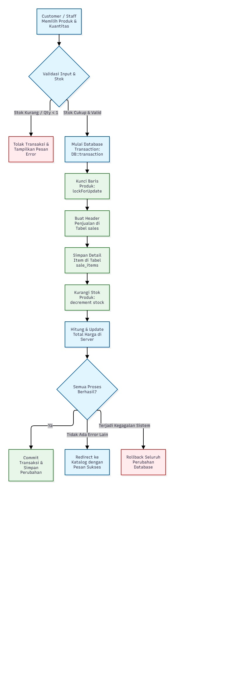
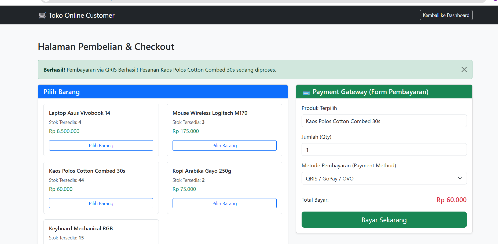

# Inventory Management System - Laravel (P5)

Migrasi Inventory Management System P4 (PHP native) ke Laravel. Business rule P4 tetap dipertahankan.

## Kebutuhan
- PHP 8.2+ dan Composer
- MySQL / MariaDB (XAMPP)
- Laravel 11 atau 12

## Instalasi (dari nol)
```bash
# 1. Buat project Laravel baru
composer create-project laravel/laravel inventory-laravel
cd inventory-laravel

# 2. Salin isi paket ini ke dalam project (timpa file yang sudah ada)
#    Windows (CMD, dari dalam folder inventory-laravel):
#      xcopy /E /Y /I ..\inventory-laravel-overlay\app app
#      xcopy /E /Y /I ..\inventory-laravel-overlay\database database
#      xcopy /E /Y /I ..\inventory-laravel-overlay\resources resources
#      xcopy /E /Y /I ..\inventory-laravel-overlay\routes routes
#      xcopy /E /Y /I ..\inventory-laravel-overlay\public public
#    Atau cukup copy-paste manual folder app, database, resources, routes, public.

# 3. Atur database di file .env (ganti bagian DB_ yang bawaannya sqlite):
#      DB_CONNECTION=mysql
#      DB_HOST=127.0.0.1
#      DB_PORT=3306
#      DB_DATABASE=inventory_db
#      DB_USERNAME=root
#      DB_PASSWORD=
#    Lalu buat database kosong "inventory_db" di phpMyAdmin
#    (atau jalankan: CREATE DATABASE inventory_db;)

# 4. Migration + seeder
php artisan migrate:fresh --seed

# 5. Jalankan
php artisan serve
```
Buka http://127.0.0.1:8000

## Akun demo
| Role | Email | Password |
|------|-------|----------|
| Admin | admin@inventory.test | password |
| Staff | staff@inventory.test | password |
| Customer | customer@gmail.com | password |
## Perintah berguna
```bash
php artisan route:list      # lihat semua route
php artisan migrate:status  # status migration
php artisan migrate:fresh --seed   # reset database + data demo
```

## Dokumentasi
- `docs/ARSITEKTUR_MVC.md` - penjelasan MVC, alur request, dan demo alur form.
- `<!-- UTS Final Update -->` - Pembaruan final layout checkout dan integrasi payment gateway.
# 🛒 Aplikasi Inventory & Sistem Pembayaran Customer (UTS Laravel)

Proyek ini adalah pengembangan sistem manajemen inventori berbasis Laravel yang dilengkapi dengan simulasi halaman pembelian dan *payment gateway* khusus untuk kebutuhan Ujian Tengah Semester (UTS).

---

## 📌 Fitur Utama Aplikasi
1. **Manajemen Inventori (Admin & Staff)**: Pengelolaan data produk, kategori, supplier, serta pencatatan stok masuk dan keluar.
2. **Katalog & Pembelian (Customer)**: Halaman khusus bagi pelanggan untuk melihat daftar produk, memilih jumlah barang, dan melakukan simulasi *checkout*.
3. **Simulasi Payment Gateway**: Dukungan pilihan metode pembayaran seperti QRIS, Transfer Bank, dan COD.

---

## 🗄️ Database & ERD (Entity Relationship Diagram)
Berikut adalah struktur basis data (*Entity Relationship Diagram*) yang digunakan dalam aplikasi inventory ini:

> 

---

## 📸 Dokumentasi Tampilan (Screenshots)

Berikut adalah beberapa tangkapan layar dari aplikasi:

### 1. Dashboard Utama
Menampilkan ringkasan statistik produk, nilai inventori, serta peringatan stok rendah.
> 

### 2. Halaman Pembelian & Payment Gateway
Tampilan halaman belanja customer lengkap dengan pilihan metode pembayaran dan tombol *checkout*.
> 

---

## 🚀 Cara Menjalankan Proyek
1. Pastikan **XAMPP** (Apache & MySQL) sudah aktif.
2. Clone atau buka direktori proyek di terminal VS Code.
3. Jalankan perintah instalasi dependensi:
   ```bash
   composer install
   npm install